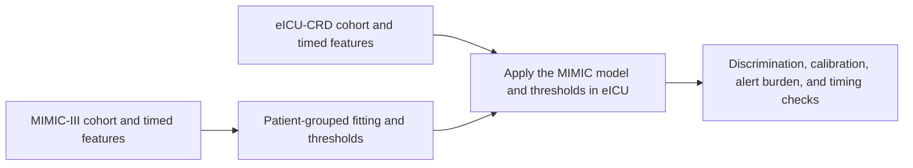

# Reproducing the v18 analysis

[Back to the manuscript analysis](../README.md)

## Study workflow



The first assessment follows a qualifying one-hour collection window beginning within 24 hours of admission. The repeat window begins at least six hours after the first begins and within 48 hours of admission. The primary analysis assumes a four-hour reporting lag. The broad cohort allows optional prior history. Experiments with historical ICD predictors use a separate eligible subgroup.

Model selection for the reported XGBoost comparison and its thresholds used MIMIC. eICU informed design checks during development, and the separate prevalence-matched arm uses the observed eICU case fraction. The reported results therefore describe cross-database performance under this study design.

## Run the study notebook

1. Obtain credentialed access to [MIMIC-III](https://physionet.org/content/mimiciii/) and [eICU-CRD](https://physionet.org/content/eicu-crd/). Store extracts outside the Git working tree. The exact analyzed database releases remain pending confirmation.
2. Set `BE_DATA_ROOT` to the directory containing MIMIC `ADMISSIONS.csv`, `PATIENTS.csv`, `DIAGNOSES_ICD.csv`, and `LABEVENTS.csv`. Put eICU `patients.csv`, `diagnoses.csv`, and `lab.csv` in `eicu/` under that directory. Add `CMS32_DESC_LONG_SHORT_DX.xlsx`, the [CMS Version 32 diagnosis dictionary](https://www.cms.gov/medicare/coding-billing/icd-10-codes/icd-9-cm-diagnosis-procedure-codes-abbreviated-and-full-code-titles).
3. Install the [reference dependencies](requirements-reference.txt) in the Jupyter kernel environment. The recorded study used Python 3.14.4. The listed mapper reproduced the saved token decisions. The original mapper and GEM release remain unverified.
4. Open [the v18 notebook](../BE_ICD_LABS_v18.ipynb) and run it in order. It builds features and fits models from local source data in `BE_integrated_grid_v18_public_rebuild_outputs` under the data root.

A full run includes the tabular grid, CNN comparisons, and reporting-lag, age, and lab-panel sensitivities. Credentialed extracts, per-admission predictions, feature banks, and model checkpoints are held locally.

From the repository root, the dependency install command is:

```sh
python -m pip install -r analysis/v18/reproducibility/requirements-reference.txt
```

The run directory contains `primary/feature_sampling_grid.csv` for tabular comparisons, `cnn_primary/cnn_comparison_results.csv` for CNNs, and `all_scenario_grid.csv` for the combined study grid. The [synthetic demo](../README.md#run-the-synthetic-demo) checks the timing and fold rules without these inputs or outputs.

## Notebook map

Cell numbers include Markdown cells.

- **Cohort and lab timing (cells 5–11 and 20).** `load_admissions` defines cases and controls. `draw_landmarks` finds qualifying lab clusters. `_build_features_batch` applies collection and availability cutoffs to the tabular summaries and sequence inputs. The ICD cells define and align historical diagnosis features.
- **Patient folds and fitting (cells 13, 25, and 35–37).** The patient splitter builds outer assignments and `inner_split` creates the training-only holdouts. Cell 35 installs the tabular model schedule and `fit_grid_partition`. Cell 37 handles run ownership, guarded checkpoint handling, and the final Stack threshold logic. Some earlier cells define fitting functions that later cells replace.
- **Evaluation (cells 41, 43, 45, 47–48, and 50).** Run the tabular grid, inspect paired landmark and lab-only comparisons, and follow the separate CNN and sensitivity runs.

## Check the manuscript results

- **[Later-coded eICU analysis](eicu_later_coded_sensitivity.py).** Supply `--data-root` and `--run-dir`. The script reads the run manifest, saved prediction vectors, and score times. Use `--feature-bank` to select an alternate bank. [Expected aggregate results](eicu_later_coded_expected.json) include the case counts, metrics, and patient-cluster intervals from the manuscript run.
- **[ICD category coverage](coverage/compute_evidence.py) and [selected-feature coverage](coverage/selected_portability.py).** Set `BE_DATA_ROOT`. For a different run or bank, set `BE_RUN_DIR` and `BE_FEATURE_BANK` to the corresponding local paths.

Example from the repository root, with paths set to the local extracts and saved run:

```sh
python analysis/v18/reproducibility/eicu_later_coded_sensitivity.py --data-root "<data-root>" --run-dir "<run-dir>" --output later_coded_results.json
```

The timing script leaves scores and thresholds fixed. It writes only aggregate results and compares the full eICU cohort with the subset eligible for the later-coded analysis.

## Manuscript run provenance

The manuscript links to a [fixed snapshot of the study code](https://github.com/SoppingBook/Precision-Medicine-BIOE5860/tree/d27bff91daf170ec56bc23a45cf56434d284b94b/analysis/v18). Its primary and CNN results used audited recovery of saved stages. The [provenance record](provenance/analysis_provenance.json) lists source checksums and recovery details. The [v15 modeling notebook](provenance/v15_model_source.ipynb) documents the earlier modeling recipe, and the [12-hour execution cells](provenance/fast12h_execution_cells.ipynb) document the cache-backed execution used for that sensitivity. Those cells depend on the original local checkpoints. The public v18 notebook uses the standard feature builder for a fresh run. Exact reproduction from a fresh build has not been established for the full recovered feature bank.

## Relationship to the course project

The [April ICD notebook](../../../Daniel_BE_ICD_Model.ipynb) built a MIMIC cohort around ICD-9 421.0, sampled controls by admission-history counts, and ran fold-level chi-squared selection and MIMIC cross-validation. V18 uses actual index admissions and accepts ICD-9 421.0, 421.1, and 421.9, plus I33-family codes in eICU. Its main laboratory cohort allows optional prior history. Historical diagnosis experiments use a separate subgroup, with same-year separate eICU stays excluded from history.

V18 uses two one-hour lab collection windows with an assumed four-hour reporting lag, training-partition preprocessing and selection, and full-MIMIC fits for cross-database evaluation. A separate prevalence-matched arm duplicates MIMIC training controls using the aggregate eICU case rate. Both evaluation cohorts retain their natural prevalence. The different cohorts, outcomes, and predictors mean the course and v18 metrics answer different questions.
